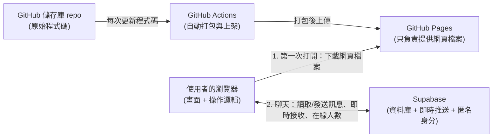
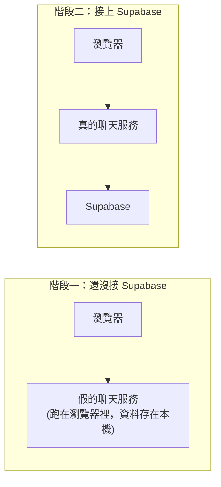
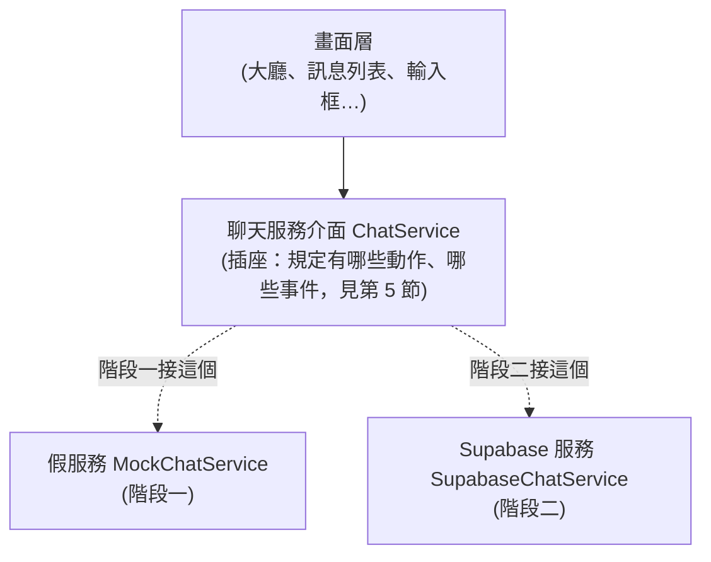
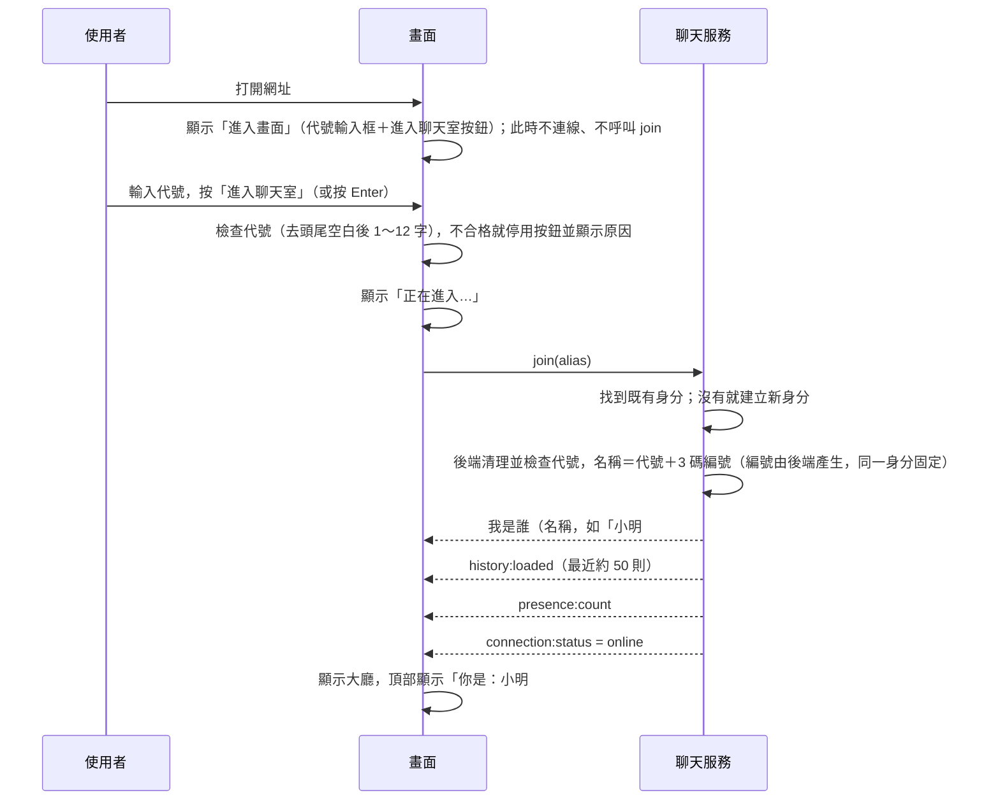
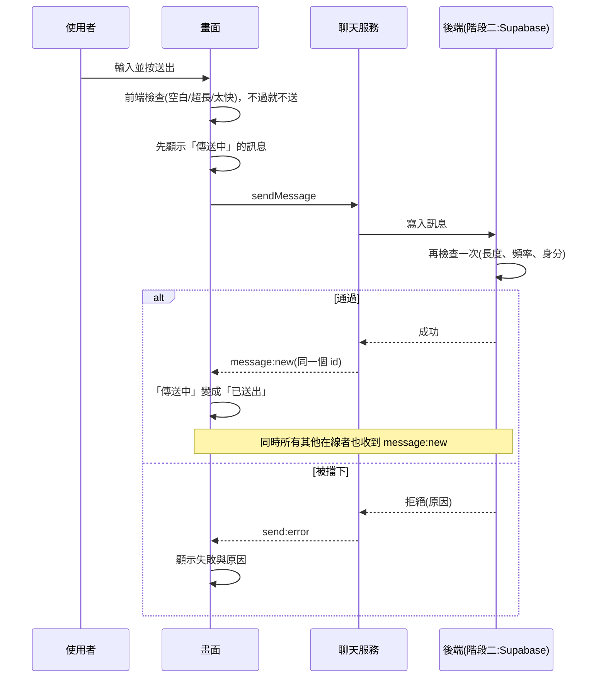
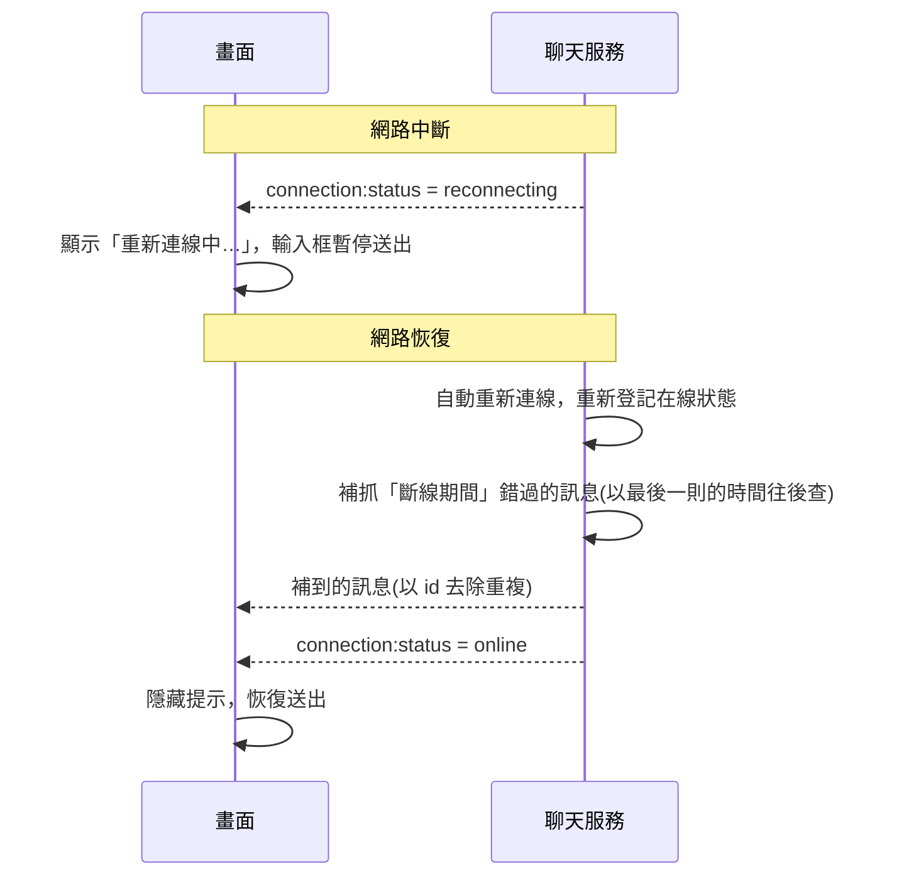

# 匿名聊天室：架構文件

> 本文件寫給「不寫程式的專案負責人」看。專有名詞第一次出現時會用一句話解釋。
> 本文件只描述「要怎麼蓋」，不包含任何程式碼，也不規定顏色與樣式（那是 `/design` 的工作）。

---

## 1. 專案說明與目標

### 這是什麼

一個網頁版的**匿名公開聊天室**。任何人打開網址，就會進到同一個共用的大廳，可以看到大家的訊息，也可以發言。

### 使用者會看到與做到什麼（已與負責人確認）

| 項目 | 決定 |
|---|---|
| 形式 | 一個所有人共用的公開大廳，沒有分房間 |
| 身分 | 進入前先輸入「代號」，名稱＝代號＋系統產生的 3 碼編號（例如「小明#371」）；編號使用者不能自己指定 |
| 編號保留 | 同一個瀏覽器每次回來編號都相同（代號可重新輸入），直到使用者清除瀏覽器資料 |
| 歷史訊息 | 進入時看到最近約 50 則，往上捲可以載入更早的 |
| 訊息內容 | 純文字，上限 500 字 |
| 發出之後 | 不能編輯、不能刪除 |
| 即時性 | 別人發的訊息即時出現，不用重新整理 |
| 線上人數與名單 | 顯示「目前 N 人在線」；點開可看到在線名單（完整名稱，自己標「（你）」）；有人進來或離開時顯示短暫提示 |
| 防濫用 | 只做發送頻率限制，超過時顯示提示；沒有檢舉、封鎖 |
| 裝置 | 手機與電腦都要好用，畫面自動配合螢幕大小 |

### 專案目標

1. 做出一個**真的能用、能公開分享網址**的聊天室。
2. **完全免費**運行（使用 GitHub Pages 與 Supabase 的免費方案）。
3. 分兩個階段完成：先做出「看得到、點得動」的畫面，再接上真正的後端。第二階段不需要把第一階段重寫。

---

## 2. 整體架構圖

### 名詞先說明

- **瀏覽器**：使用者用來開網頁的軟體（Chrome、Safari 等）。聊天室的畫面與操作邏輯都跑在這裡。
- **GitHub Pages**：GitHub 提供的免費「網頁放置處」。我們把做好的網頁檔案放上去，全世界就能用網址打開。它**只能放靜態檔案**（不會自己處理資料，也不能存訊息）。
- **Supabase**：一個現成的「後端服務」，負責存資料、即時推送訊息、辨認使用者。有免費方案。
- **後端**：使用者看不到的那一側，負責保存資料與守規則。

### 誰跟誰在溝通



重點：

- **GitHub Pages 與 Supabase 彼此不認識。** 瀏覽器先向 GitHub Pages 拿到網頁，之後所有「聊天」的事情，瀏覽器都直接找 Supabase。
- 因為 GitHub Pages 不能放秘密，所以**所有規則的把關必須做在 Supabase 那一側**（第 9 節會說明）。

### 階段一與階段二的差別



---

## 3. 技術選擇

每一項都寫「選了什麼」與「為什麼」。

### 3.1 前端（使用者看到的那一側）

| 項目 | 選了什麼 | 為什麼 |
|---|---|---|
| 程式語言 | **TypeScript**（JavaScript 加上「型別檢查」，會在寫錯資料格式時提前警告） | 本專案有「通訊約定」（第 5 節），用 TypeScript 可以讓電腦幫忙檢查資料格式有沒有寫錯，減少低級錯誤 |
| 畫面框架 | **React**（一套把畫面拆成小積木的工具） | 聊天室的畫面會一直變動（新訊息、人數變化），React 擅長處理「資料變了，畫面自動跟著變」；資源與範例也最多 |
| 打包工具 | **Vite**（把原始碼整理成瀏覽器能直接用的檔案的工具） | 設定簡單、速度快，輸出的是純靜態檔案，正好符合 GitHub Pages 只能放靜態檔案的限制 |
| 樣式 | **一般 CSS**（`src/styles.css`，用 CSS 變數管理顏色與尺寸） | 外觀細節（顏色、字體、各畫面規格）記錄在 `docs/design.md`，由 `/design` 產出 |

### 3.2 後端（Supabase 用到的功能）

Supabase 有很多功能，**本專案只用下面四個**：

| Supabase 功能 | 用來做什麼 | 為什麼選它 |
|---|---|---|
| **Database（資料庫）**：存資料的地方，這裡是 Postgres 資料庫 | 保存所有訊息、保存每位使用者的暱稱 | 訊息要長期保存、要能「取最近 50 則」與「載入更早的」，資料庫最適合 |
| **Realtime 的 Postgres Changes（即時推送）**：資料庫一有新資料，就立刻通知正在連線的瀏覽器 | 讓新訊息即時出現，不用重新整理 | 比自己寫「每幾秒問一次有沒有新訊息」更即時，也更省額度；而且「誰能收到什麼」會遵守下面的權限規則 |
| **Realtime 的 Presence（在線狀態）**：自動記錄「目前有哪些人在線」，人離開會自動消失（本專案以匿名身分為單位，同一個人開好幾個分頁只算一人） | 顯示「目前 N 人在線」 | 這是專門做「在線人數」的現成功能，不用自己寫「誰離開了」的判斷 |
| **Realtime 的 Postgres Changes 也用在表情回應**：`reactions` 資料表一有人按或收回，就推送給所有人 | 表情回應即時同步 | 跟新訊息同一套機制，不用另外寫推送 |
| **Realtime 的 Broadcast（廣播）**：瀏覽器之間經由 Supabase 轉送的即時小訊號，不存進資料庫 | 顯示「某某 正在輸入…」 | 這種暫時性的訊號不需要保存，用廣播最省；要節流以免用掉免費的即時訊息額度 |
| **Anonymous Sign-ins（匿名登入）**：不需要帳號密碼，系統自動給每個瀏覽器一個隨機身分並記住它 | 讓「同一個瀏覽器永遠是同一個暱稱」 | 完全符合需求：沒有註冊流程，清掉瀏覽器資料後身分就消失 |

另外兩個**資料庫內部的規則機制**（不是額外服務，是資料庫自帶的）：

- **Row Level Security（資料列權限，簡稱 RLS）**：用規則規定「誰可以讀、誰可以寫哪幾筆資料」。例如「任何人都能讀訊息，但不能修改或刪除任何訊息」。
- **Trigger（觸發器）**：資料寫入前自動執行的檢查。用來做「頻率限制」與「長度檢查」。

> **為什麼把規則放在資料庫，而不是只在前端擋？**
> 因為前端的程式碼在使用者的瀏覽器裡，任何人都能繞過它、直接對 Supabase 發請求。所以前端的檢查只是「體貼使用者」，真正的把關必須在資料庫。

### 3.3 部署

| 項目 | 選了什麼 | 為什麼 |
|---|---|---|
| 網頁放置 | **GitHub Pages** | 免費、與程式碼放在同一處 |
| 自動上架 | **GitHub Actions**（GitHub 的自動化機器人，你更新程式碼它就自動打包上架） | 你不用手動上傳檔案 |

---

## 4. 兩個階段，以及如何避免重寫

### 階段一：還沒接 Supabase

**目標**：先把完整的畫面與操作做出來，而且**放在 GitHub Pages 上就能打開看效果**，不需要任何後端。

前端用一個「**假的聊天服務**」代替 Supabase，它跑在瀏覽器裡：

| 功能 | 階段一怎麼模擬 |
|---|---|
| 3 碼編號 | 第一次進來時產生，存在瀏覽器的本機儲存（`localStorage`，瀏覽器內建的小型儲存空間），之後固定 |
| 歷史訊息 | 預先放約 60 則範例訊息，用來測試「最近 50 則」與「往上捲載入更早」 |
| 發送訊息 | 存進瀏覽器本機；同一個瀏覽器的其他分頁也會即時看到（用 `BroadcastChannel`，瀏覽器內建的分頁之間的傳話功能） |
| 即時收訊 | 偶爾由「機器人」自動丟出假訊息，方便看新訊息出現時的畫面行為 |
| 在線人數與名單 | 自己、其他分頁的身分（同一身分只算一人），加上 2～5 個會隨機進出的假人（機器人名稱）；進出時同樣會出現提示 |
| 頻率限制 | 在假服務裡實作同樣的規則，畫面上會看到同樣的提示 |
| 斷線與各種失敗 | 網址加上 `?debug=1` 會出現測試面板（只有展示模式有）：「模擬斷線／恢復連線」「下一則傳送失敗」「下次載入更早失敗」「模擬連線失敗」。模擬斷線超過 60 秒也會跟正式服務一樣放棄並顯示「無法連線」 |

**在 GitHub Pages 上怎麼看到效果**：打包後上架，打開網址即可。畫面上會有一條明顯的提示：「目前為展示模式，訊息只存在你的瀏覽器」，避免誤會。想看到「多人」效果：同一個瀏覽器的所有分頁預設共用同一個身分（符合「同一個瀏覽器固定暱稱」的需求），所以兩個分頁其實是「同一個人」，彼此的訊息都會顯示成自己的。要用兩個分頁扮演兩個人，兩個分頁的網址都要加上 `?debug=1`，這樣每個分頁各自有一個身分。

**階段一能做到什麼程度**：所有畫面、所有按鈕、所有提示文字、手機與電腦版面，以及第 6 節的全部流程，都可以完整驗證。**做不到的只有一件事**：真正的「不同人、不同裝置之間的互通」。

### 階段二：接上 Supabase 之後的改變

只換掉「聊天服務」這一層，其他不動：

| 項目 | 階段一 | 階段二 |
|---|---|---|
| 訊息存放 | 瀏覽器本機 | Supabase 資料庫 |
| 即時推送 | 分頁之間傳話 | Supabase Realtime |
| 在線人數 | 數本機分頁（另加假人數） | Supabase Presence（以人為單位，同一個人開多個分頁只算一人） |
| 身分 | 本機隨機產生 | Supabase 匿名登入 |
| 編號產生與代號檢查 | 前端產生 | 資料庫產生與檢查（防止偽造；`enter_with_alias`） |
| 頻率限制與長度檢查 | 假服務內實作 | 資料庫 Trigger 實作（前端仍保留同樣檢查，只為了提示更即時） |
| 畫面上的「展示模式」提示 | 顯示 | 移除 |

### 如何避免整個重寫：「插座」設計

把「聊天服務」想像成**一個標準插座**。畫面（插頭）只認得插座的形狀，不在乎插座後面接的是假的還是真的。



設計守則（這是整份架構最重要的一條）：

1. **畫面層絕對不可以直接碰 Supabase。** 畫面只能呼叫「聊天服務介面」。
2. **介面（第 5 節的約定）在階段一就定死**，假服務與真服務都必須遵守同一份。
3. **用一個設定值切換**使用哪一個服務（例如設定檔裡的「模式：展示 / 正式」），切換不需要改畫面程式。
4. **假服務要刻意模擬真實會發生的壞事**：延遲、發送失敗、被頻率限制、斷線。這樣階段二接上後，畫面已經處理過這些情況。
5. **暱稱產生、頻率限制這類「規則」只寫一份規格**（第 9 節），假服務與資料庫各依規格實作一次，行為必須一致。

---

## 5. 通訊約定

這是「聊天服務介面」的內容，也就是畫面與服務之間說話的規矩。階段一的假服務與階段二的真服務**都必須照做**。

### 5.1 畫面對服務下的指令

| 指令 | 說明 | 參數 | 結果 |
|---|---|---|---|
| `join` | 進入大廳（使用者按下「進入聊天室」後才會呼叫） | `alias`（使用者輸入的代號，去頭尾空白後 1～12 字） | 成功回傳「我是誰」（暱稱＝代號＋「#」＋3 碼編號，如「小明#371」），並接著觸發歷史訊息與人數事件；代號不合規則時丟出錯誤 |
| `sendMessage` | 發送一則訊息 | `id`（前端先產生的訊息編號，見 5.3）、`content`（文字） | 成功時由 `message:new` 確認；失敗時以 `send:error` 事件回報（原因見 5.4） |
| `loadOlder` | 載入更早的訊息 | `before`（目前最舊那則的時間與編號） | 回傳最多 50 則更早的訊息；沒有更早的就回報「已到底」；失敗時丟出錯誤，畫面顯示「載入更早的訊息失敗」與重試（見第 7 節） |
| `toggleReaction` | 對一則訊息按表情（已按過同一種就收回） | `messageId`、`emoji`（固定 6 種：👍 ❤️ 😂 😮 😢 🎉） | 回傳按完之後這個回應是否存在；失敗時丟出錯誤（訊息文字如 `RATE_LIMITED`），畫面顯示提示 |
| `notifyTyping` | 告訴大家「我正在輸入」 | 無 | 畫面在輸入框有內容且變動時直接呼叫；服務自己節流（最多每 3 秒送一次），離線時忽略。不會有回應 |
| `leave` | 離開大廳 | 無 | 停止接收事件，在線人數減一 |

### 5.2 服務通知畫面的事件

| 事件名稱 | 何時發生 | 帶的資料 |
|---|---|---|
| `history:loaded` | `join` 完成後，送出最近約 50 則 | 訊息清單（舊到新排序） |
| `message:new` | 有新訊息（包含自己剛送出的，作為確認） | 單則訊息 |
| `presence:count` | 在線人數變動 | 一個整數 |
| `presence:list` | 在線名單變動 | 名單（每人有 `authorId`、`nickname`；同一人開多個分頁只算一人） |
| `reactions:loaded` | 載入歷史或更早訊息時，附帶載入這些訊息的回應；重連後也會重新載入最近的 | `messageIds` 與 `reactions`（這些訊息原本的回應以這次為準） |
| `reaction:changed` | 有人新增或收回回應 | `reaction`（`messageId`、`authorId`、`emoji`）與 `active`（true＝新增）。自己按的以 `toggleReaction` 的回傳為準，不重複處理 |
| `typing` | 別人正在輸入（不含自己） | `authorId`、`nickname`。畫面收到後顯示 5 秒，期間沒再收到、或該人的訊息送出時就消失 |
| `presence:notice` | 別人進來或離開（不含自己；自己剛連上時，已經在線的人不算「進來了」，等自己出現在名單裡才開始比對） | `kind`（`join`／`leave`）與 `nickname` |
| `connection:status` | 連線狀態改變 | `connecting`（連線中）／`online`（正常）／`reconnecting`（斷線重連中）／`failed`（失敗） |
| `send:error` | 某則訊息送出失敗 | 該訊息的暫時編號與錯誤代碼 |

### 5.3 資料格式

**一則訊息（Message）**

| 欄位 | 內容 | 說明 |
|---|---|---|
| `id` | 唯一編號（UUID：一串幾乎不會重複的隨機編號） | 由**前端發送時先產生**，用來避免同一則訊息顯示兩次 |
| `authorId` | 發言者的匿名編號 | 隨機產生、不含任何個人資料；畫面用它判斷「這是不是我發的」（我的訊息靠右） |
| `nickname` | 發言者暱稱 | 例如「小明#371」（代號＋3 碼編號） |
| `content` | 訊息文字 | 純文字，1～500 字 |
| `createdAt` | 發出時間 | 以**伺服器時間**為準（階段二）；顯示時轉成使用者當地時間 |

**我是誰（Me）**

| 欄位 | 內容 |
|---|---|
| `authorId` | 我的匿名編號 |
| `nickname` | 我的暱稱 |

**送出前的狀態**：畫面上自己的訊息會先顯示成「傳送中」，收到同一個 `id` 的 `message:new` 後變成「已送出」；收到 `send:error` 則顯示「失敗」並提供「重試」。

### 5.4 錯誤代碼

| 代碼 | 意思 | 畫面上看到什麼（文字待 `/design` 微調） |
|---|---|---|
| `EMPTY` | 內容為空或只有空白 | 送出鈕不可按，不特別提示 |
| `TOO_LONG` | 超過 500 字 | 字數計數變色並提示 |
| `RATE_LIMITED` | 發太快 | 「發言太快了，請稍等幾秒」 |
| `OFFLINE` | 目前沒有連線 | 「目前離線，連線後可再試」 |
| `UNKNOWN` | 其他未預期錯誤 | 「送出失敗，請重試」 |

> 階段二的資料庫另外會回傳 `NO_PROFILE`（還沒取得暱稱）與 `NOT_AUTHENTICATED`（沒有登入身分）。這兩種正常使用下不會發生，前端一律歸為 `UNKNOWN`。

### 5.5 頻率限制的初始數值（可調整）

**每個人 10 秒內最多 5 則**，另外**兩則之間至少間隔 0.5 秒**。數值是暫定的，正式上線後若太鬆或太緊再調整。

另外，**斷線後重連超過 60 秒仍沒恢復**，就放棄並顯示「無法連線」（程式裡的 `RECONNECT_GIVE_UP_MS`，同樣可調整）。

---

## 6. 資料流

### 6.1 進入聊天室

打開網頁**不會**自動連線，也不會自動給暱稱。使用者要先在進入畫面輸入代號，按「進入聊天室」才開始。



- 第一次來：建立新身分與新的 3 碼編號。
- 再次來（同一個瀏覽器）：沿用既有身分，**編號不變**；代號可以重新輸入（換代號但編號相同）。
- 編號與代號的最終檢查在資料庫（Supabase 的 `enter_with_alias`，見 `supabase/migrations/0002_alias.sql`），前端無法指定或偽造編號。
- 進入失敗：顯示「無法連線」畫面與「重試」按鈕（沿用剛才的代號），也可選「改用其他代號」回到進入畫面（見第 7 節）。

### 6.2 送出訊息



### 6.3 離開

- **正常離開**（關閉分頁、切走網站）：服務先取消在線登記（`untrack`）再停止接收，其他人的名單與人數馬上更新，並看到「某某離開了」。
- 瀏覽器有時不會好好通知「我走了」（例如直接當機、手機直接鎖屏），所以**在線人數靠 Presence 的自動逾時機制**，一段時間沒心跳就視為離開。因此人數減少可能延遲數秒到數十秒，這是正常現象。
- 身分與暱稱**不會**因離開而消失，下次回來還是同一個。

### 6.4 斷線重連



- 補抓訊息時以 `id` 去除重複，避免同一則顯示兩次。
- 若斷線太久、錯過的訊息超過一頁，就改為重新載入最近約 50 則。
- 斷線後 60 秒內仍沒恢復，服務停止所有連線，狀態改為 `failed`，畫面顯示「無法連線」與「重試」；按重試會重新走一次進入流程（6.1）。

---

## 7. 畫面清單

只描述「有什麼元素、各自的行為」，不規定顏色、字體、間距。

### 畫面 0：進入畫面（打開網頁第一個看到的畫面）

| 元素 | 行為 |
|---|---|
| 標籤「代號」 | `<label for="alias">`，對應下方輸入框 |
| 代號輸入框 | `id="alias"`、`name="alias"`、提示文字「輸入你的代號」、`maxlength="12"` |
| 不合格原因 | 去頭尾空白後少於 1 字或超過 12 字時，輸入框下方顯示原因 |
| 「進入聊天室」按鈕 | `<button type="submit">`，放在 `<form>` 裡，按 Enter 也能送出；代號不合格時停用。**按下之前不連線、不呼叫 `join`** |
| （階段一）展示模式提示 | 說明目前是展示模式 |

### 畫面 A：進入中

| 元素 | 行為 |
|---|---|
| 載入提示 | 按下「進入聊天室」後顯示「正在進入聊天室…」，進入完成後自動切到畫面 B |
| （階段一）展示模式提示 | 說明目前是展示模式 |

### 畫面 B：聊天大廳（主畫面）

| 區塊 | 元素 | 行為 |
|---|---|---|
| 頂部 | 標題 | 顯示聊天室名稱 |
| 頂部 | 線上人數 | 顯示「目前 N 人在線」，即時更新；點一下展開在線名單（完整名稱，自己標「（你）」），再點收合 |
| 頂部 | 進出提示 | 有人進來或離開時，頂部下方顯示「某某 進來了／離開了」，6 秒後自動消失；連續進出時提示會疊加（最多同時 3 則），不會互相蓋掉 |
| 頂部 | 我的名稱 | 顯示「你是：小明#371」（代號＋3 碼編號），**不可編輯**；旁邊有「離開」按鈕 |
| 頂部 | 離開按鈕 | 按下後呼叫 `leave`（先取消在線登記），回到進入畫面，可以換代號再進入；其他人會看到「某某 離開了」 |
| 頂部 | 連線狀態 | 正常時不佔位；`reconnecting` 時顯示「重新連線中…」 |
| 訊息區 | 訊息列表 | 舊的在上、新的在下。每則顯示暱稱、內容、時間 |
| 訊息區 | 自己的訊息 | 與他人訊息有明顯區別（靠右） |
| 訊息區 | 訊息狀態 | 自己的訊息顯示「傳送中／已送出／失敗」；失敗時有「重試」 |
| 訊息區 | 載入更早 | 捲到最上面時載入更早 50 則；全部載完顯示「已經是最早的訊息」；載入失敗時顯示「載入更早的訊息失敗」與「重試」按鈕，不會自動重試，等使用者按下 |
| 訊息區 | 自動捲動 | 使用者停在底部時，新訊息進來自動捲到最底；若使用者正在往上看舊訊息，**不強制拉走**，改顯示「有 N 則新訊息」的按鈕，點了才跳到底 |
| 訊息區 | 空狀態 | 還沒有任何訊息時顯示「還沒有人說話，來打個招呼吧」 |
| 訊息區 | 表情回應 | 每則已送出的訊息下方顯示已有的表情與人數（自己按過的有底色，再點一下收回），旁邊有「＋」展開 6 種表情選單；別人按的即時出現。被頻率限制時顯示「發言太快了」 |
| 輸入框上方 | 正在輸入 | 有人輸入時顯示「某某 正在輸入…」（2 人顯示兩個名字，3 人以上顯示「某某 等 N 人正在輸入…」）；5 秒沒更新或對方送出訊息就消失。固定佔一行高度，不會讓版面跳動 |
| 底部 | 輸入框 | 可輸入多行文字；Enter 送出、Shift+Enter 換行（手機上以送出鈕為主） |
| 底部 | 字數計數 | 永遠顯示「N / 500」；超過 500 字時變色並提示 |
| 底部 | 送出鈕 | 內容為空白、超長、離線時不可按 |
| 底部 | 發言提示 | 被頻率限制時顯示「發言太快了，請稍等幾秒」，一段時間後自動消失 |

### 畫面 C：無法連線

| 元素 | 行為 |
|---|---|
| 錯誤說明 | 顯示「目前無法連線到聊天室」 |
| 重試按鈕 | 用剛才的代號重新執行進入流程（6.1） |
| 「改用其他代號」 | 回到進入畫面（畫面 0） |

> 手機與電腦都要好用：同一套畫面自動配合螢幕寬度調整；手機上輸入框要避開虛擬鍵盤，不被遮住。具體排版交給 `/design`。

---

## 8. 金鑰

### 名詞先說明

- **金鑰（Key）**：一串長長的字，像是「通行證」，證明你有權限對 Supabase 做某些事。
- **Commit**：把檔案存入 Git 的版本紀錄。一旦 commit 並推到 GitHub，就等於**公開了**（就算之後刪掉，歷史紀錄裡仍找得到）。

### 本專案會碰到的東西

| 名稱 | 是什麼 | 哪裡產生 | 可以公開嗎 |
|---|---|---|---|
| **Project URL** | 你的 Supabase 專案網址 | Supabase 後台建立專案時自動給 | ✅ 可以（本來就會出現在網頁裡） |
| **Publishable key / anon key（可公開金鑰）** | 給「前端」用的通行證，權限很低，只能做 RLS 規則允許的事 | Supabase 後台 → 專案設定 → API 金鑰 | ✅ 可以。它**一定會被打包進網頁**，任何人看原始碼都拿得到，所以設計上就假設它是公開的。**安全性靠 RLS 規則，不靠藏這把鑰匙** |
| **Secret key / service_role key（秘密金鑰）** | 萬能鑰匙，**無視所有 RLS 規則**，能讀寫刪全部資料 | 同上頁面 | ❌ **絕對不行**。本專案**根本用不到**它，所以不應該拿出來、不應該複製到任何地方 |
| **資料庫密碼** | 建立專案時設定的 Postgres 密碼 | 你建立專案時自己設定 | ❌ 絕對不行。本專案前端不會用到，只有直接連資料庫維運時才會用 |
| **Supabase 帳號登入** | 你登入 Supabase 後台的帳密 | — | ❌ 絕對不行；建議開啟兩步驟驗證 |
| **GitHub 帳號 / 權杖（token）** | 登入或推送程式碼的憑證 | — | ❌ 絕對不行 |

一句話記憶：**只有「Project URL」與「可公開金鑰」會出現在這個專案裡；其他都不該出現。**

### 放在哪裡

| 情境 | 放在哪裡 |
|---|---|
| 你自己的電腦上開發 | 專案根目錄的 `.env.local` 檔（專門放環境設定的檔案）。此檔**被列在 `.gitignore`（Git 的忽略清單）**，不會被 commit |
| 給別人看的範本 | `.env.example`：只寫「需要哪些欄位」與假的範例值，**可以** commit |
| GitHub Actions 自動打包時 | 放在 GitHub 儲存庫的 **Settings → Secrets and variables → Actions**，打包時才注入。不寫在任何檔案裡 |

> 注意：即使放在 GitHub Secrets，**可公開金鑰最後仍會出現在打包後的網頁裡**，這是正常的、預期的。放進 Secrets 的好處是：不用寫死在原始碼裡，也方便日後更換。

### 怎麼避免被 commit 到 GitHub

1. **第一次 commit 前**就建立好 `.gitignore`，內容包含 `.env`、`.env.local`、`.env.*.local`。
2. 只 commit `.env.example`，內含的值是假的。
3. 啟用 GitHub 的 **Secret scanning 與 Push protection**（GitHub 內建功能：偵測到金鑰時會警告，甚至擋下推送）。
4. 絕不使用 `service_role`／secret key：不取得、不貼到對話、不寫進任何檔案。
5. 若不小心 commit 了任何秘密：**立刻到 Supabase 後台重新產生（輪替）那把金鑰**。光是把檔案刪掉無效，因為歷史紀錄仍在。
6. 在階段一**完全不需要**任何金鑰，天然零風險。

---

## 9. 安全與限制

### 9.1 別人可能送什麼奇怪的東西進來

**重要前提**：任何人都可以繞過我們的網頁，直接對 Supabase 發請求。所以下表的每一項，「後端」欄才是真正的防線；「前端」欄是為了讓正常使用者體驗順暢。

| 可能的怪東西 | 前端怎麼擋 | 後端怎麼擋（階段二） |
|---|---|---|
| **空訊息或全空白** | 送出鈕不可按；送出前去掉頭尾空白 | 資料庫檢查：去除空白後長度必須 ≥ 1 |
| **超長訊息** | 輸入框限制 500 字並顯示計數 | 資料庫檢查：長度必須 ≤ 500 |
| **夾帶網頁程式碼**（例如 `<script>`，想在別人瀏覽器執行；稱為 XSS 攻擊） | 訊息一律當**純文字**顯示，**絕不**用會解析網頁語法的方式輸出；也不把訊息中的網址變成可點連結 | 不需要額外處理，因為資料只當文字存放 |
| **洗版**（短時間狂發） | 送出前先檢查頻率，太快就不送並顯示提示（不是按鈕冷卻） | 資料庫 Trigger：每人 10 秒最多 5 則、間隔至少 0.5 秒 |
| **一整串沒有空格的長字**（把版面撐破） | 版面設定為長字自動換行 | — |
| **大量換行**（一則訊息佔滿整個螢幕） | 連續換行最多保留一個空行（3 個以上換行折成 2 個）；不限制總行數 | 資料庫做同樣的折疊 |
| **隱形或控制字元**（零寬字元、文字方向反轉字元，可造成假冒或版面錯亂） | 送出前過濾這類字元 | 資料庫同樣過濾或拒絕 |
| **收到格式不對的訊息**（資料被竄改、欄位缺漏或型別不符） | 收到的訊息先檢查欄位格式（id、authorId、nickname、content、createdAt 的型別與長度），不合格就丟棄，通過後才當純文字顯示，不當 HTML。歷史、即時、載入更早三個入口共用同一個檢查（`src/rules` 的 `parseMessage`） | 資料庫欄位本身已有型別與長度限制 |
| **亂按表情**（不在清單內的表情、對不存在的訊息按、狂按） | 選單只有 6 種；收到的回應先檢查格式（`parseReaction`），不合格丟棄 | `toggle_reaction()`：只接受 6 種表情、訊息必須存在、每人 10 秒最多新增 10 次；`reactions` 表前端無法直接寫入 |
| **假冒他人**（請求裡謊稱自己是別的暱稱） | 前端不讓使用者填暱稱 | 暱稱由資料庫依登入身分自動填入，請求中帶的暱稱一律忽略 |
| **修改或刪除別人的訊息** | 畫面上沒有這功能 | RLS：**完全不開放**任何人更新或刪除訊息 |
| **假冒系統公告**（訊息內文寫「系統：…」） | 畫面上系統提示與使用者訊息樣式截然不同 | — |
| **同代號混淆或冒用**（別人也取同樣的代號，例如都叫「小明」） | 前端不阻止；畫面一律顯示「代號#編號」 | 編號由資料庫產生並盡量避開同代號同編號，但**不保證唯一**，也不禁止同代號；見 9.4 |
| **大量建立匿名身分來繞過頻率限制** | 無法在前端擋 | 靠 Supabase 對匿名登入的流量限制；本版不再加強（見第 10 節） |

### 9.2 免費方案的上限（需要留意）

> 以下數字是撰寫時的概略值，**Supabase 與 GitHub 可能調整**，正式上線前請以官方當下的方案頁面為準。

| 服務 | 上限（概略） | 對本專案的影響 |
|---|---|---|
| Supabase 資料庫容量 | 約 500 MB | 純文字訊息很小，短期內不會用完；但訊息永久累積，長期仍會增長 |
| Supabase Realtime 同時連線數 | 約 200 條 | **同時在線超過約 200 人就會有人連不上**，這是本專案最先遇到的天花板 |
| Supabase Realtime 每月訊息數 | 約 200 萬則 | 一則訊息會被推送給每一位在線者，所以「訊息數 × 在線人數」會快速累積 |
| Supabase 匿名登入頻率 | 有每個網路位址的次數限制 | 同一個辦公室或學校網路下大量新使用者同時進入時，可能暫時登入失敗 |
| Supabase 閒置暫停 | 免費專案**約一週沒有活動會被暫停** | 久沒人用，下次打開會連不上，需要到後台手動恢復 |
| GitHub Pages | 網站容量約 1 GB、每月流量約 100 GB（軟性限制）；免費帳號通常需要**公開的**儲存庫 | 本專案的網頁很小，不成問題；也代表程式碼是公開的，所以更不能放秘密 |
| GitHub Actions | 公開儲存庫的使用量實務上很寬鬆 | 不成問題 |

### 9.3 連線不穩時的畫面保護

- 任何失敗都要有可見的提示，不可讓畫面卡住不動也沒說明。
- 服務出錯時，已經載入的訊息仍然保留，不清空。

### 9.4 已知限制

- **代號可以重複**：任何人都能取跟別人一樣的代號（只是編號不同），單看代號仍可能混淆或冒用。編號由資料庫產生、前端不能指定，但同一代號只有 1000 種編號，也不保證兩人不同；要完全避免需要帳號制，本版不做。
- **在線名單的名稱來自各瀏覽器**：Presence 的資料是每個瀏覽器自己登記的，不像訊息的暱稱由資料庫填。惡意使用者繞過網頁可以在「在線名單」裡掛別的名字（不影響訊息上的名稱）。前端會檢查名稱格式（1～20 字），自己的名稱一律用資料庫給的；名單只做參考。
- **「正在輸入」訊號用 Realtime Broadcast**：不經過資料庫、不保存，但每個訊號都會推送給所有在線者，計入免費方案的即時訊息額度（見 9.2）。因此送出端節流為每 3 秒最多一次。訊號由各瀏覽器自己送出，沒有驗證來源，惡意使用者可以冒用別人的名稱發出「正在輸入」；前端只檢查名稱格式，影響僅限畫面上一行暫時性提示。
- **訊息永久保存**：訊息存在資料庫，不自動清除，容量長期會增長（見 9.2）。
- **畫面一次只載入最近 50 則**：更早的靠往上捲動分頁載入。
- **離開的偵測**：正常關閉分頁會馬上更新；斷網、當機、手機鎖屏靠 Presence 逾時，名單與人數減少會延遲數秒到數十秒。

---

## 10. 這一版刻意不做的事

| 不做 | 為什麼 |
|---|---|
| 註冊／登入／帳號 | 目標就是匿名；匿名登入已足夠辨認同一個瀏覽器 |
| 多個房間、私訊、配對 | 已確認只做單一公開大廳 |
| 自訂完整暱稱 | 使用者只能輸入代號，編號由系統給定；避免冒充 |
| 編輯、刪除訊息 | 已確認；匿名環境也難以證明「這是我發的」 |
| 圖片、檔案、貼圖、連結預覽 | 已確認只做純文字；避免上傳與審核問題 |
| 檢舉、封鎖、管理員後台、自動內容過濾 | 已確認只做頻率限制；檢舉需要有人審核，成本高，留待之後 |
| 線上名單的額外資訊 | 名單只顯示名稱（代號#編號），不顯示加入時間、位置等；名稱本來就公開在訊息裡，所以不增加洩漏 |
| 已讀回條 | 不在需求內，且會增加即時流量，更容易碰到免費額度（「正在輸入…」已做，見第 7 節） |
| 推播通知、聲音提示 | 不在需求內 |
| 訊息自動清除／過期 | 需求沒說要；容量先靠免費額度撐，日後有需要再補 |
| 防機器人驗證（如 CAPTCHA，一種「證明你是人」的小測驗） | 先維持零摩擦進入；若日後被大量濫用再加 |
| 多語系 | 先只做繁體中文 |
| 自訂網域 | 先用 GitHub Pages 預設網址 |
| 自動化測試的大型投入 | 本版以「驗證清單」（第 13 節）人工驗收為主 |

---

## 11. repo 的資料夾結構

```
anonymous-chat/
├─ docs/
│   ├─ requirements.md         需求說明（需求決定表、新增功能、已知限制）
│   ├─ architecture.md         本文件
│   └─ design.md               畫面設計：顏色、字體、各畫面規格
├─ src/
│   ├─ main.tsx                程式進入點
│   ├─ styles.css              全站樣式（CSS 變數見 design.md）
│   ├─ vite-env.d.ts           環境變數的型別宣告
│   ├─ ui/                     畫面層（只認得「聊天服務介面」，不碰 Supabase）
│   │   ├─ App.tsx             依進入狀態切換三個畫面
│   │   ├─ useChat.ts          把服務的事件整理成畫面要用的狀態
│   │   ├─ DevPanel.tsx        測試面板（網址加 ?debug=1，只有展示模式）
│   │   ├─ screens/            畫面 A 進入中、B 大廳、C 無法連線
│   │   └─ components/         訊息列表、輸入框、頂部列、圖示等小積木
│   ├─ chat/                   聊天服務層
│   │   ├─ types.ts            第 5 節的資料格式與錯誤代碼
│   │   ├─ ChatService.ts      「聊天服務介面」（插座）
│   │   ├─ emitter.ts          兩種服務共用的事件發送器
│   │   ├─ mock/               階段一：假服務與範例訊息
│   │   ├─ supabase/           階段二：Supabase 服務
│   │   └─ createChatService.ts  依設定決定用假的或真的
│   ├─ rules/                  共用規則：字數上限、字元過濾、頻率限制數值、重連放棄時間
│   └─ config/                 讀取環境設定（模式、Supabase 網址與可公開金鑰）
├─ supabase/                   階段二：資料庫設定的文字紀錄
│   ├─ migrations/             建資料表、RLS 規則、Trigger 的紀錄檔（0001 基礎、0002 代號、0003 表情回應）
│   └─ README.md               如何在後台套用
├─ .github/
│   └─ workflows/              GitHub Actions：自動打包並部署到 Pages
├─ index.html                  網頁入口
├─ package.json                相依套件與指令（dev、build、preview）
├─ tsconfig.json、vite.config.ts  TypeScript 與打包設定（含 GitHub Pages 基底路徑）
├─ .env.example                環境設定範本（假值，可 commit）
├─ .env.local                  本機真正的設定（被忽略，不會 commit）
├─ .gitignore                  忽略 .env.local 等不該上傳的檔案
├─ CLAUDE.md                   給 Claude 的專案規則
└─ README.md                   如何啟動與部署
```

重點：`ui/` 與 `chat/supabase/` 之間隔著 `ChatService`，這就是第 4 節「插座」的實體位置。

---

## 12. 部署到 GitHub Pages 的方式

1. **GitHub 儲存庫設定**：Settings → Pages，來源選「GitHub Actions」。
2. **自動流程**（每次把程式碼推上 `main` 分支就觸發）：
   1. GitHub Actions 取得最新程式碼
   2. 把 Project URL 與可公開金鑰從 Secrets 注入（階段一不需要）
   3. 用 Vite 打包成靜態檔案
   4. 上傳到 GitHub Pages
3. **網址**：通常是 `https://<帳號>.github.io/<儲存庫名稱>/`。
4. **子路徑問題**：網址最後多了一段「儲存庫名稱」，打包時必須告訴 Vite 這個**基底路徑**，否則網頁會找不到自己的檔案而一片空白。這是 GitHub Pages 最常見的新手坑。
5. **單一頁面**：本專案只有一個頁面，不做網址切換，因此不會遇到「重新整理後 404」的問題。
6. **階段切換**：階段一部署時設定為「展示模式」；階段二補上 Secrets 並改為「正式模式」後重新部署即可。
7. **回復**：若新版有問題，把 `main` 退回上一個版本再推送，Pages 會自動換回舊版。

---

## 13. 驗證清單

### 階段一（假服務，GitHub Pages 上驗證）

**畫面與流程**
- [ ] 打開網址 → **第一個看到的是進入畫面**（有「代號」標籤與輸入框、「進入聊天室」按鈕），尚未連線、尚未顯示任何暱稱
- [ ] 代號空白或全空白：按鈕停用並顯示原因；超過 12 字（輸入框最多只收 12 字）也不能進入
- [ ] 輸入代號後按按鈕、或在輸入框按 Enter，都能進入 → 看到「進入中」→ 進入大廳
- [ ] 大廳頂部顯示「你是：代號#三碼編號」（例如「小明#371」）
- [ ] 大廳顯示標題、人數、我的暱稱（不可編輯）、訊息區、輸入區
- [ ] 展示模式提示可見
- [ ] 重新整理後再用同一代號進入，名稱（含編號）**不變**；換一個代號，編號仍相同；清除瀏覽器資料後編號**改變**

**訊息**
- [ ] 進入時看到最近約 50 則歷史訊息，順序正確
- [ ] 往上捲到頂可載入更早訊息；全部載完顯示「已經是最早的訊息」
- [ ] 送出一則訊息：先「傳送中」再「已送出」，且只顯示一次
- [ ] 自己的訊息與他人的訊息外觀有區別
- [ ] 同一瀏覽器開兩個分頁，一邊發言另一邊即時出現（預設是同一個人，訊息會顯示成自己的；兩個分頁網址都加 `?debug=1` 才會各是不同的人）
- [ ] 機器人訊息會自動進來
- [ ] 停在底部時自動捲到最新；往上看舊訊息時不被拉走，改出現「有 N 則新訊息」

**輸入檢查**
- [ ] 空白或全空白：不可送出
- [ ] 輸入 501 字：有提示且不可送出；500 字可以
- [ ] 快速連發：出現「發言太快了」提示，之後恢復
- [ ] 貼上 `<script>alert(1)</script>`、`<b>粗體</b>`：原樣顯示為文字，不執行也不變粗體
- [ ] 一長串無空格文字：不撐破版面
- [ ] 大量換行：連續換行被折疊成最多一個空行
- [ ] Enter 送出、Shift+Enter 換行（電腦）

**線上人數與連線**
- [ ] 兩個分頁網址都加 `?debug=1`，多開／關閉分頁，人數與名單正確增減，並出現「進來了／離開了」提示
- [ ] 點「目前 N 人在線」展開名單，自己標「（你）」，再點收合
- [ ] 對別人的訊息按表情：下方出現「👍 1」，自己按過的有底色；再點一下收回；同一則訊息可以有多種表情；自己的訊息也可以被別人按
- [ ] 另一邊即時看到表情新增與收回；重新整理後表情與人數仍在；往上載入的舊訊息也帶著表情
- [ ] 連續快速按很多次出現「發言太快了」
- [ ] 一邊在輸入框打字，另一邊在輸入框上方看到「某某 正在輸入…」；停止輸入約 5 秒後消失；對方送出訊息時立刻消失；自己打字時自己看不到
- [ ] 按頂部「離開」回到進入畫面，可換代號再進入；另一邊看到「離開了」，再進入時看到「進來了」
- [ ] 模擬斷線：顯示「重新連線中」、輸入暫停；恢復後訊息補齊、無重複
- [ ] 模擬斷線超過 60 秒：自動出現畫面 C，「重試」可用
- [ ] 載入更早失敗：顯示「載入更早的訊息失敗」與「重試」，不會自動重試；按重試可成功載入
- [ ] 模擬連線失敗：出現畫面 C，「重試」可用
- [ ] 傳送失敗時顯示「失敗」與「重試」

**裝置與部署**
- [ ] 手機（直式、橫式）與電腦版面都可用，無橫向捲軸
- [ ] 手機鍵盤彈出時輸入框不被遮住
- [ ] GitHub Pages 網址能正常載入，沒有空白頁（基底路徑正確）
- [ ] 原始碼與打包結果中**找不到**任何金鑰

### 階段二（接上 Supabase）

**身分與暱稱**
- [ ] 第一次輸入代號進入，得到「代號#三碼編號」；重新整理後用同一代號進入，名稱相同
- [ ] 同一個瀏覽器換代號再進入，編號不變
- [ ] 換另一個瀏覽器（或無痕視窗）得到**不同**編號
- [ ] 編號是資料庫產生的，不是前端傳來的；繞過網頁直接呼叫 `enter_with_alias`，空白、超過 12 字的代號被拒絕，控制字元被移除

**即時互通（需要兩台以上裝置或兩個不同瀏覽器）**
- [ ] A 發言，B 在 1～2 秒內看到，且不需重新整理
- [ ] 自己發的訊息只顯示一次
- [ ] 一邊打字，另一邊看到「正在輸入…」，停止後消失（階段二用兩個不同瀏覽器驗證）
- [ ] 在線人數與名單隨兩台裝置進出而變化（同一個人開多個分頁只算一人），對方名稱完整顯示、自己標「（你）」
- [ ] 對方進來或離開時，另一邊看到「某某 進來了／離開了」提示
- [ ] 對方正常關閉分頁後，人數與名單馬上減少；直接斷網或當機則靠逾時，可能延遲數十秒
- [ ] 歷史訊息正確：新裝置進入看到最近約 50 則，往上載入更早

**後端把關（用繞過網頁、直接對 Supabase 發請求的方式測試）**
- [ ] 沒有任何方式可以修改或刪除既有訊息
- [ ] 超過 500 字的請求被拒絕
- [ ] 空白訊息被拒絕
- [ ] 偽造暱稱無效，顯示的仍是自己的暱稱
- [ ] 短時間狂發被擋下，畫面顯示「發言太快了」
- [ ] 以未登入身分直接讀寫，被拒絕

**斷線與重連**
- [ ] 關掉網路再打開：顯示重連中，恢復後補齊錯過的訊息、無重複，人數重新登記
- [ ] 關掉網路超過 60 秒：出現畫面 C「無法連線」；恢復網路後按「重試」可回到大廳
- [ ] 斷線期間嘗試送出：顯示離線提示，不會默默消失

**金鑰與部署**
- [ ] 網頁中只出現 Project URL 與可公開金鑰，**沒有**秘密金鑰或資料庫密碼
- [ ] 整個 Git 歷史搜尋不到秘密金鑰
- [ ] `.env.local` 沒有被追蹤
- [ ] 「展示模式」提示已移除
- [ ] 自動部署成功，GitHub Pages 網址上的正式版可以完整走過上述流程

**容量與限制認知**
- [ ] 已確認免費方案當下的連線數、容量、閒置暫停規則，並記下超過時的處理方式
